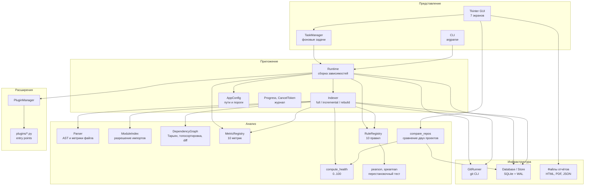
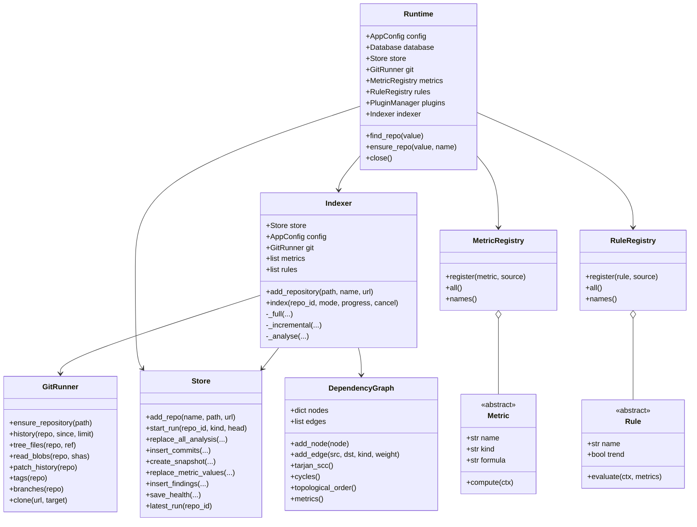
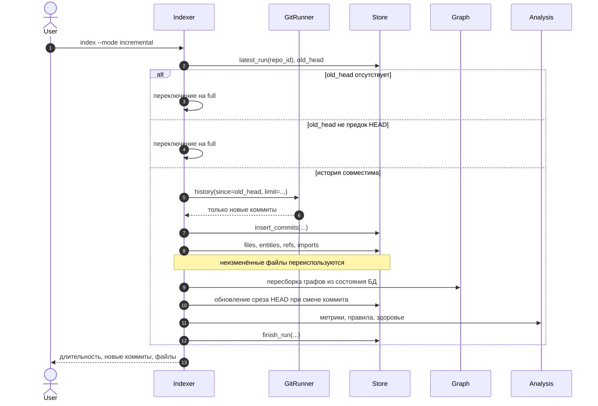

# Архитектура

## 1. Назначение и ограничения

ProjectPulse строит локальный цифровой двойник Python-проекта по Git-репозиторию. Система отвечает на вопросы: насколько проект здоров, где сосредоточены риски, как меняется состояние во времени, какие зависимости связывают файлы и сущности, что делать в первую очередь.

Архитектура следует четырём ограничениям задания:

- работа без сети после клонирования репозиториев;
- отсутствие прав администратора;
- только стандартная библиотека и разрешённые зависимости;
- запрет на готовые анализаторы кода и графовые библиотеки для основных алгоритмов.

Поэтому Git вызывается через CLI, хранение построено на SQLite, интерфейс - на Tkinter, графовые алгоритмы реализованы вручную.

## 2. Слои системы

| Слой | Пакет | Ответственность |
| --- | --- | --- |
| Представление | `projectpulse.ui`, `projectpulse.app` | Tkinter-экран, CLI, фоновые задачи, прогресс |
| Приложение | `projectpulse.core.runtime`, `projectpulse.indexer` | сборка зависимостей, оркестрация импорта |
| Анализ | `projectpulse.analysis` | парсер, импорты, графы, метрики, правила, здоровье, статистика |
| Инфраструктура | `projectpulse.gitio`, `projectpulse.storage` | git CLI, SQLite, схема, запросы |
| Расширения | `projectpulse.core.plugins`, `plugins/` | реестры метрик и правил, загрузка плагинов |

Зависимости направлены внутрь: UI знает о runtime, runtime собирает анализ и инфраструктуру, анализ не импортирует UI. Плагины видят только контракты `Metric`, `Rule` и контейнер сервисов.

## 3. UML-диаграмма компонентов



## 4. UML-диаграмма классов ядра



## 5. Сценарий полного импорта

```mermaid
sequenceDiagram
    autonumber
    actor User
    participant CLI as CLI / GUI
    participant IDX as Indexer
    participant GIT as GitRunner
    participant PAR as Parser
    participant ST as Store
    participant AN as Analysis
    participant REP as Report

    User->>CLI: index --mode full
    CLI->>IDX: index(repo_id, "full")
    IDX->>ST: start_run(kind="full", head)
    IDX->>GIT: history(bugfix_pattern)
    GIT-->>IDX: коммиты и изменения файлов
    IDX->>ST: insert_commits(...)
    IDX->>GIT: tree_files(HEAD)
    IDX->>GIT: read_blobs(партиями)
    IDX->>PAR: analyze_bytes(...)
    PAR-->>IDX: LOC, сущности, импорты, сложность
    IDX->>ST: replace_all_analysis(...)
    IDX->>AN: build_file_graph, build_entity_graph
    IDX->>GIT: tags, branches
    IDX->>PAR: разбор срезов с общим кэшем
    IDX->>ST: create_snapshot(HEAD, теги, ветки)
    IDX->>AN: метрики, правила, здоровье
    IDX->>ST: metric_values, findings, health
    IDX->>ST: finish_run(...)
    CLI-->>User: сводка импорта
    User->>REP: report --format html,pdf
    REP->>ST: последний успешный запуск
    REP-->>User: HTML и PDF
```

## 6. Сценарий инкрементального импорта



Инкрементальный режим не пытается "дописать" метрики к старым значениям. Он пересчитывает анализ из актуального состояния БД, но не перечитывает неизменённые файлы и не пересоздаёт все срезы. Это сохраняет согласованность ценой полного прохода по метрикам.

## 7. Плагинная расширяемость

Точки расширения:

1. `Metric` - новый показатель с методом `compute(ctx)`, возвращающим `MetricValue`.
2. `Rule` - новое правило с методом `evaluate(ctx, metrics)`, возвращающим `Finding`.
3. `MetricRegistry` и `RuleRegistry` - реестры с сортировкой по имени для детерминизма.
4. `PluginManager` - загрузка из entry points `projectpulse.metrics` и `projectpulse.rules`, а также из каталогов `*.py`.
5. `ServiceContainer` - минимальный DI-контейнер: `config`, `store`, `git`, `metrics`, `rules`, `logger`, `indexer`, `plugins`.
6. `register(container)` - необязательный хук плагина для доступа к сервисам.

Порядок загрузки: entry points, затем каталог плагинов в домашнем каталоге приложения, затем встроенный каталог `plugins/`. Ошибка одного плагина журналируется и не останавливает импорт. Подробнее: [plugins.md](plugins.md).

## 8. Детерминизм

- Все SQL-выборки, списки файлов, узлов и срезов сортируются.
- `created_at` и `generated_at` отражают реальное время запуска, но метрики и графики от него не зависят.
- Метрики времени считаются относительно максимального timestamp коммита, а не текущей даты.
- Перестановочный тест использует фиксированный seed 42.
- Пороги вынесены в `Thresholds` и могут быть переопределены `thresholds.json`.
- Идентификаторы сущностей стабильны: `module_entity_id` и `stable_id`.

## 9. Обработка ошибок

| Ситуация | Поведение |
| --- | --- |
| Каталог не является Git-репозиторием | `GitError`, понятное сообщение в CLI и GUI |
| Нет коммитов или файлов | пустые ряды и отчёт без падения |
| Синтаксическая ошибка в файле | файл сохраняется с `parse_error`, анализ продолжается |
| Битый или несовместимый плагин | предупреждение в журнале, плагин пропускается |
| Расхождение истории | автоматический переход на полный импорт |
| Отмена импорта | `IndexCancelled`, запуск помечается отменённым |
| Нет reportlab | PDF-формат возвращает понятную ошибку, HTML работает |
| Ошибка открытия отчёта | сообщение в интерфейсе, файл остаётся на диске |

## 10. Ключевые решения

| Решение | Причина |
| --- | --- |
| Git CLI вместо dulwich | меньше зависимостей, точное поведение Git, проще отладка |
| SQLite + WAL | локальность, транзакции, параллельное чтение из GUI |
| Tkinter | входит в стандартную библиотеку, работает без администратора |
| Собственный AST-парсер | запрет на готовые анализаторы, полный контроль формул |
| Ручной Тарьян | запрет на графовые библиотеки для ядра |
| reportlab только для PDF | HTML полностью автономен, PDF опционален |
| Фиксированные seed и сортировки | воспроизводимость результатов и тестов |
