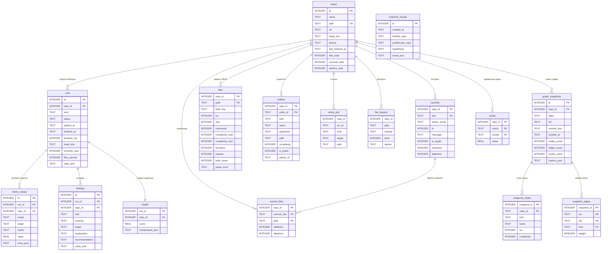

# Модель данных

## 1. Общая схема

Хранилище - один файл SQLite. Схема создаётся идемпотентно из `src/projectpulse/storage/schema.sql` при старте `Database`. Включены `PRAGMA foreign_keys = ON`, режим WAL и `synchronous = NORMAL`. Версия схемы хранится в `meta` (`schema_version = 1`).

Каждый поток получает собственное соединение, поэтому GUI может читать данные, пока фоновый импорт пишет. Транзакции выполняются через контекстный менеджер `Database.tx()`.

## 2. ER-диаграмма

## 3. Назначение таблиц

### Репозиторий и запуски

- `repos` - зарегистрированные проекты, текущий HEAD, ветка, агрегаты и время последней индексации. `path` уникален.
- `runs` - журнал импортов. `kind` принимает `full`, `incremental`, `rebuild`; `status` - `running`, `ok`, `cancelled`, `error`. `stats_json` хранит длительности фаз, число файлов и ошибки разбора.
- `commits` - все коммиты с числом вставок и удалений, флагом багфикса и временем. Первичный ключ `(repo_id, sha)`.
- `commit_files` - изменения по файлам, первичный ключ `(repo_id, commit_sha, path)`.

### Модель кода HEAD

- `files` - LOC, SLOC, комментарии, пустые строки, суммарная и максимальная сложность, число функций и классов, TODO, текст ошибки разбора. Первичный ключ `(repo_id, path)`.
- `entities` - функции, классы, методы. `entity_id` стабилен и строится из пути и квалифицированного имени. `parent_id` задаёт вложенность.
- `entity_refs` - ссылки "вызов", "наследование", "использование", "композиция" с целевым именем. Разрешение в конкретную сущность выполняется при построении графа.
- `file_imports` - импорты с модулем, уровнем относительности и списком имён.

### Версии графа

- `graph_snapshots` - срез графа: HEAD, тег или ветка. Хранит commit SHA, число узлов, рёбер и циклов, а также агрегированные метрики.
- `snapshot_nodes` - узлы среза.
- `snapshot_edges` - рёбра среза, первичный ключ `(snapshot_id, src, dst, kind)`.

Срез неизменяем: при повторном импорте создаётся новый снимок, старый остаётся для сравнения. Полный импорт создаёт срезы для HEAD, до 8 последних тегов и до 5 веток; инкрементальный добавляет или обновляет только срез HEAD. Число файлов в срезе ограничено 2500.

### Результаты анализа

- `metric_values` - значения метрик в разрезах `project`, `module`, `file`, `entity`. Первичного ключа нет, строки привязаны к запуску; перед записью значения запуска заменяются целиком.
- `findings` - срабатывания правил с уровнем, целью, объяснением, рекомендацией и JSON-значениями.
- `health` - одна строка на запуск: итоговый балл и компоненты штрафа.
- `series` - недельные ряды для динамики и исследования. Ключ `(repo_id, metric, bucket)`.
- `research_results` - сохранённые результаты мини-исследования.

## 4. Логические связи без внешних ключей

Некоторые связи намеренно не оформлены внешними ключами, чтобы упростить массовую замену данных при импорте:

- `files.path` и `entities.path` логически ссылаются на путь файла, но не на строку `files`, потому что файл может быть удалён или переименован между запусками.
- `entity_refs.src_id` ссылается на `entities.entity_id`, но допускает временные несогласованности после инкрементального обновления; граф пропускает неизвестные источники.
- `research_results.healthy_repo` и `problematic_repo` хранят имена, а не ID, чтобы отчёт оставался читаемым после удаления проекта.

## 5. Инварианты

1. `repos.path` уникален: один каталог - одна запись.
2. Удаление репозитория каскадно удаляет запуски, коммиты, файлы, сущности, срезы, метрики, находки, здоровье и ряды.
3. Удаление запуска каскадно удаляет его метрики, находки и здоровье.
4. `health` имеет не более одной строки на запуск.
5. `series` имеет не более одной строки на `(repo_id, metric, bucket)`.
6. `snapshot_nodes` и `snapshot_edges` не существуют без среза.
7. Срез не меняется после создания. Повторный импорт добавляет новый срез или обновляет только HEAD-срез инкрементального режима.
8. Все значения метрик конечны: деление защищено `safe_div`, сложные формулы ограничены `clamp`.

## 6. Почему SQLite

- Нулевая настройка и отсутствие административных прав.
- Один файл `projectpulse.db` в домашнем каталоге приложения.
- Транзакции и каскадное удаление.
- Достаточная скорость для сотен тысяч строк истории.
- WAL позволяет фоновому импорту писать, пока GUI читает.

Файлы отчётов и журнал лежат рядом с базой в `PROJECTPULSE_HOME`: `projectpulse.db`, `projectpulse.log`, `reports/`, `plugins/`, `cache/`.
