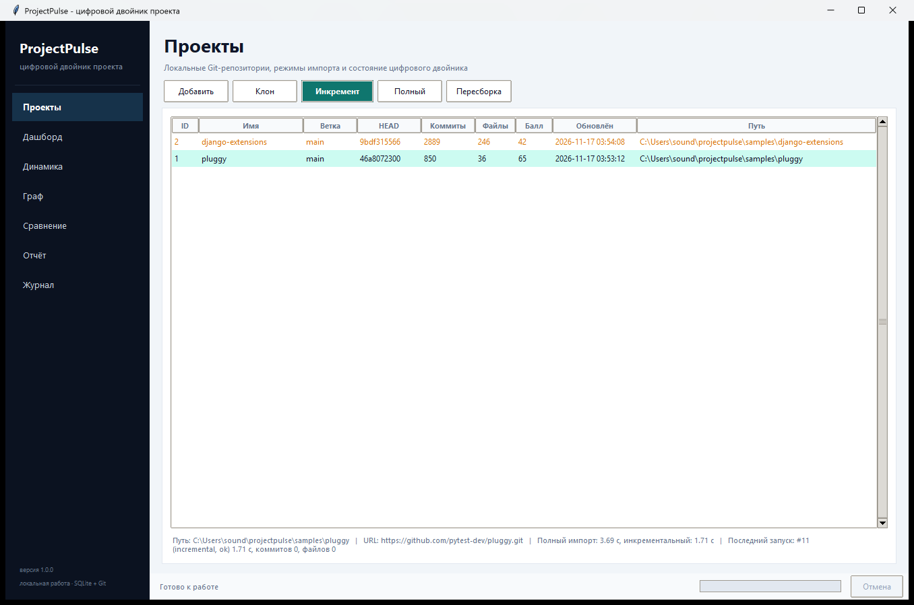
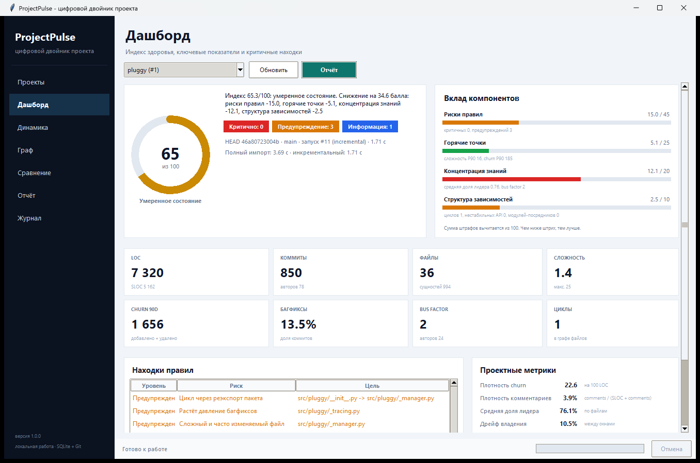
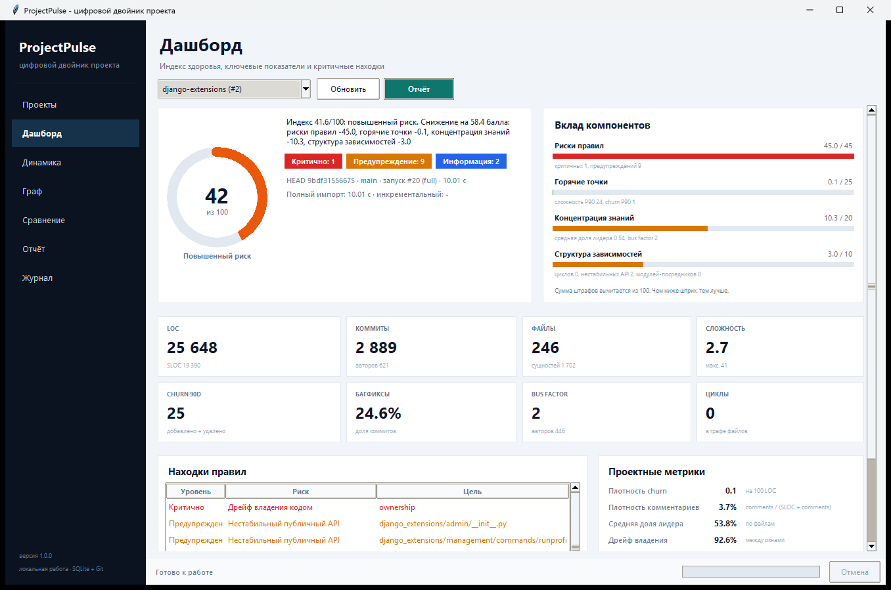
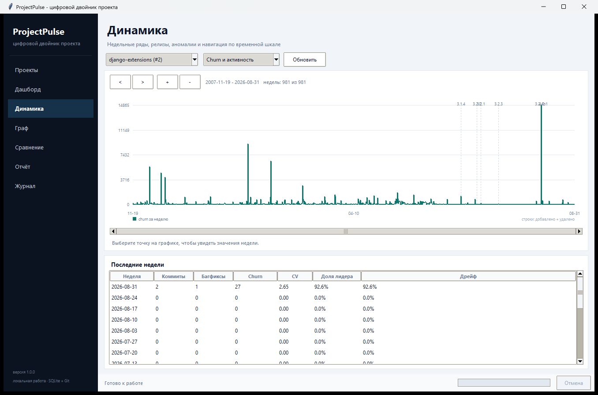
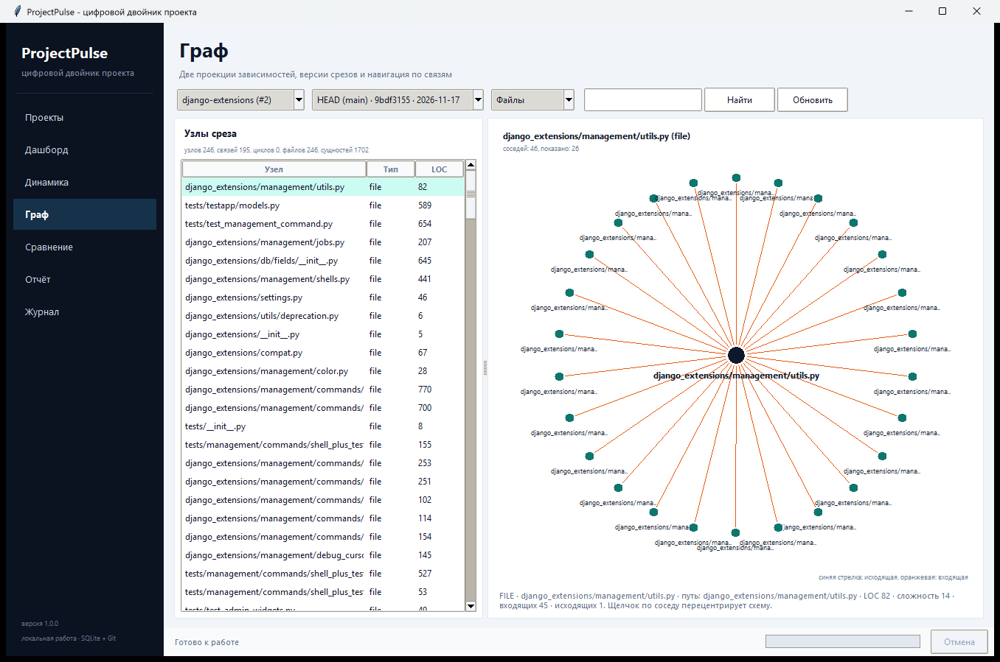
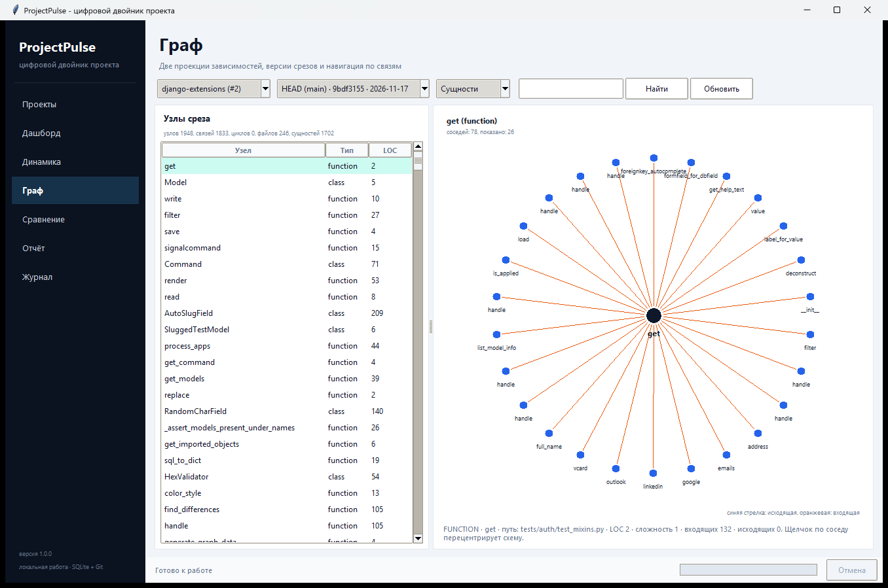
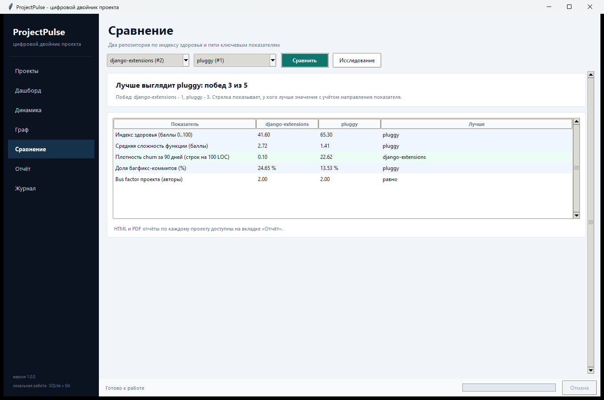
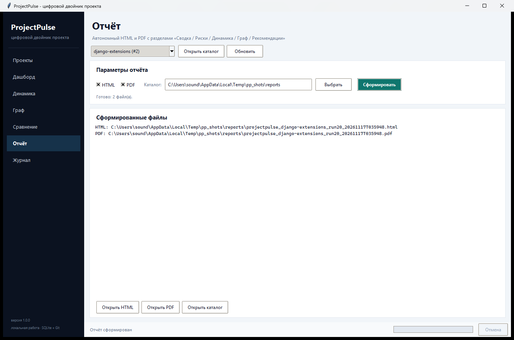
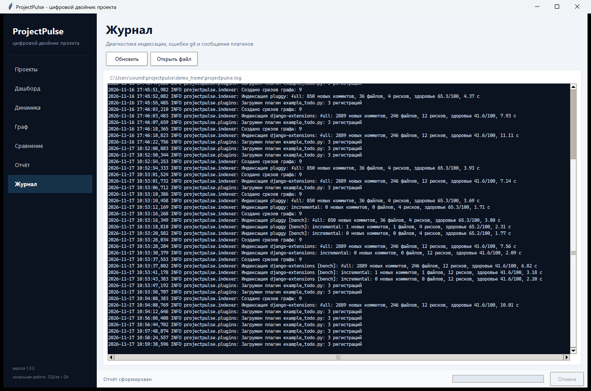

# Интерфейс

## 1. Общая компоновка

Графический интерфейс построен на Tkinter и входит в стандартную библиотеку. Окно имеет размер 1340x860, минимальный размер 1120x720, слева постоянная навигация, сверху заголовок экрана и панель действий, снизу строка состояния с прогрессом.

Экраны:

1. Проекты.
2. Дашборд.
3. Динамика.
4. Граф.
5. Сравнение.
6. Отчёт.
7. Журнал.

Все длительные операции - импорт, клонирование, отчёт, исследование - выполняются в фоновом потоке. Задача отправляет события прогресса в очередь, главный поток обновляет интерфейс через `after(80)`. Ошибка показывается диалогом, а не закрывает приложение.

На Windows интерфейс отдаёт масштабирование окна системе, а не включает поточечный per-monitor DPI. Это сохраняет согласованность фиксированных пиксельных размеров Tk и размеров шрифтов при масштабе 200%.

## 2. Проекты

Назначение: зарегистрировать локальный репозиторий и запустить нужный режим импорта.

- **Добавить** - выбрать существующий каталог с Git-репозиторием.
- **Клон** - клонировать репозиторий по URL в выбранный каталог.
- **Инкремент** - дочитать новые коммиты и пересчитать анализ.
- **Полный** - перестроить цифровой двойник с нуля по всей истории.
- **Пересборка** - удалить состояние проекта и выполнить полный импорт заново.

Таблица показывает имя, ветку, HEAD, число коммитов и файлов, время последней индексации. Выбранный проект становится активным для остальных экранов. Если репозиторий ещё не индексирован, дашборд предложит запустить импорт.

## 3. Дашборд

Назначение: за один экран понять состояние проекта.

- Круговой индикатор здоровья с баллом 0-100 и меткой состояния.
- Бейджи числа критичных, предупреждающих и информационных находок.
- Строка контекста: HEAD, ветка, номер запуска, длительность, время полного и инкрементального импорта.
- Вклад четырёх компонентов здоровья: риски, горячие точки, концентрация знаний, структура. Каждый компонент показывает штраф, максимум и долю.
- Ключевые показатели: LOC, коммиты, файлы, сложность, churn, bus factor, доля ведущего автора, FPI и другие.
- Список находок с уровнем и рекомендацией.

На проблемном проекте видно разницу: 41.6 против 65.3, больше предупреждений и критичный цикл.

## 4. Динамика

Назначение: увидеть, как менялось состояние во времени.

- Выбор проекта и группы рядов: "Churn и активность", "Коммиты и багфиксы", "Волатильность churn", "Владение кодом".
- Недельные графики с осями, подписями и легендой.
- Отметки релизов по тегам.
- Аномальные недели и последние 12 недель в таблице.
- Переключение групп не перезагружает данные из Git, а берёт готовые ряды из SQLite.

Экран отвечает на вопросы: когда был всплеск изменений, растёт ли нестабильность, меняется ли ведущий автор, совпадают ли всплески с релизами.

## 5. Граф

Назначение: исследовать зависимости и версии среза.

- Выбор среза: HEAD, тег или ветка, с commit SHA и датой.
- Переключение проекции "Файлы" и "Сущности".
- Список узлов с типом, LOC и степенью; поиск по имени и пути.
- Эго-граф вокруг выбранного узла: входящие и исходящие связи, подписи, легенда.
- Щелчок по соседу перецентрирует схему на нём.
- Карточка узла: тип, путь, LOC, сложность, fan-in, fan-out.
- Сводка среза: узлы, связи, циклы, файлы, сущности.
- Циклы и diff к предыдущему срезу.

Проекция файлов показывает импорты между файлами. Проекция сущностей показывает вызовы, наследование и композицию между модулями, классами и функциями. Обе строятся вручную, без графовых библиотек.

## 6. Сравнение

Назначение: сопоставить два проекта по здоровью и пяти ключевым показателям.

- Два выпадающих списка проектов.
- Кнопка "Сравнить" строит таблицу показателей с направлением "лучше" и вердикт.
- Кнопка "Исследование" запускает мини-исследование по выбранной паре и сохраняет Markdown и JSON.
- Для демонстрационной пары результат: pluggy 65.30, django-extensions 41.60, побед 3 из 5 в пользу pluggy.

Сравнение помогает не только увидеть разницу, но и объяснить её: рядом с каждым показателем указано, какой проект выглядит лучше и почему.

## 7. Отчёт

Назначение: сформировать автономные файлы для сдачи и обсуждения.

- Флажки HTML и PDF.
- Каталог назначения с выбором через диалог.
- Кнопка "Сформировать" запускает сборку в фоне.
- Список созданных файлов и кнопки "Открыть HTML", "Открыть PDF", "Открыть каталог".

HTML не содержит внешних скриптов, стилей и картинок: графики встроены как SVG, стили - в `<style>`. PDF строится через reportlab и содержит те же разделы.

Обязательные разделы отчёта:

1. Сводка.
2. Риски.
3. Динамика.
4. Граф зависимостей.
5. Рекомендации.
6. Приложение о воспроизводимости.

## 8. Журнал

Назначение: диагностика без консоли.

- Показывает последние 600 строк `projectpulse.log`.
- Кнопка "Обновить" перечитывает файл.
- Кнопка "Открыть файл" запускает системный редактор.
- Ошибки Git, предупреждения плагинов и этапы импорта попадают в журнал.

## 9. Сценарий работы

1. Открыть "Проекты", добавить или клонировать репозиторий.
2. Нажать "Полный" для первого импорта.
3. Открыть "Дашборд" и посмотреть здоровье и находки.
4. Открыть "Динамику" и найти всплески и смену владения.
5. Открыть "Граф", выбрать срез HEAD и проекцию, найти цикл или посмотреть окружение узла.
6. Открыть "Сравнение" и сопоставить здоровый и проблемный проекты.
7. Открыть "Отчёт", выбрать HTML и PDF, сформировать файлы.
8. При ошибке открыть "Журнал" и посмотреть причину.

## 10. Доступность и устойчивость

- Все действия доступны с клавиатуры через стандартные элементы Tkinter.
- Длинные подписи сокращаются в таблицах, но полный путь виден в карточке узла.
- Пустые состояния объясняют, что сделать дальше, вместо пустого экрана.
- Кнопки блокируются на время фоновой задачи, повторный запуск не создаёт конфликт.
- Отмена импорта доступна через токен задачи и отражается в статусе.
- Ошибки показываются с типом и текстом, а не молча теряются.
